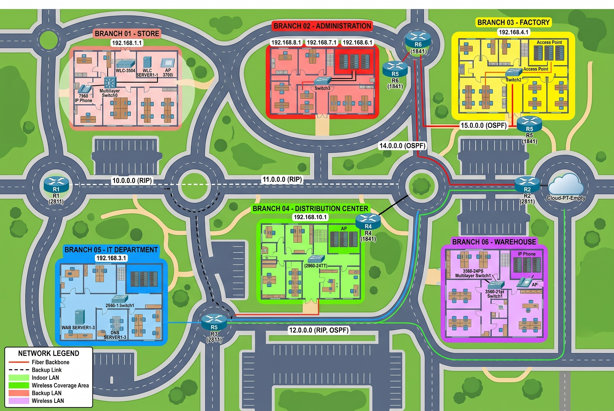
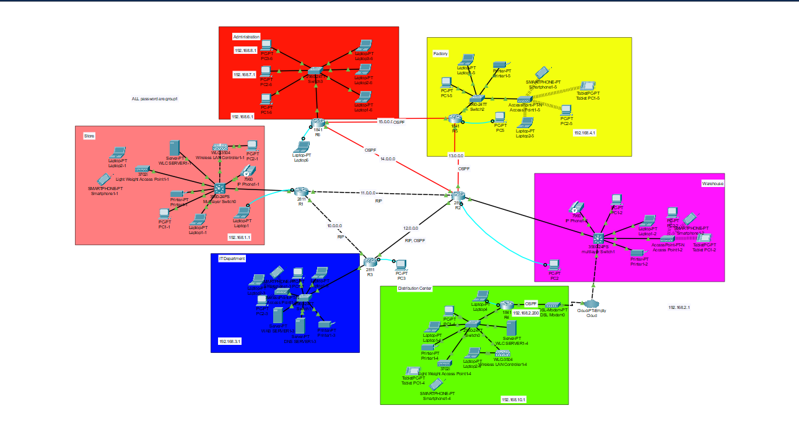

<div align="center">

# 🌐 Enterprise Multi-Branch Network Infrastructure

### A scalable 6-branch corporate network simulated in Cisco Packet Tracer


**Developed by Mohamed Mahmoud Shehata**
Academic Project | CIS 326 – Network Administration | IAU

</div>

---

## 📑 Table of Contents
- [Project Overview](#-project-overview)
- [Branches, Subnets & VLANs](#-branches-subnets--vlans)
- [Inter-Router Links](#-inter-router-links)
- [Technical Implementation](#️-technical-implementation)
- [Network Views](#-network-views)
- [Sample Configurations](#-sample-configurations)
- [Verification & Results](#-verification--results)
- [Skills Demonstrated](#-skills-demonstrated)
- [How to Run](#️-how-to-run)
- [Repository Structure](#-repository-structure)
- [Author](#-author)

---

## 📋 Project Overview

This project is a sophisticated enterprise network designed for a corporation with **6 distributed branches**: Store, Administration, Factory, Distribution Center, IT Department, and Warehouse.

It demonstrates a highly scalable infrastructure built in **Cisco Packet Tracer**, simulating a real-world environment through both a **Logical** and a **Physical** implementation.

### 🎯 Goals
- Connect all branches through a fully reachable 6-router network
- Combine multiple routing protocols using route redistribution
- Isolate each branch with VLANs for security and traffic control
- Provide voice, wireless, and core services (DNS / Web) across the company

---

## 🏢 Branches, Subnets & VLANs

| # | Branch | Router | Gateway / Subnet | VLAN ID |
|:-:|---|:-:|---|:-:|
| 1 | 🏬 Store | R1 (2811) | 192.168.1.1 | 100 |
| 2 | 🏛️ Administration | R6 (1841) | 192.168.6.1 / 7.1 / 8.1 | 10, 20, 30 |
| 3 | 🏭 Factory | R5 (1841) | 192.168.4.1 | 300 |
| 4 | 🚚 Distribution Center | R4 (1841) | 192.168.10.1 | 500 |
| 5 | 💻 IT Department | R3 (2811) | 192.168.3.1 | 200 |
| 6 | 📦 Warehouse | R2 (2811) | 192.168.2.1 | 400 |

---

## 🔗 Inter-Router Links

| Network | Connects | Protocol |
|---|---|---|
| 10.0.0.0 | R1 ↔ R3 | RIPv2 |
| 11.0.0.0 | R1 ↔ R2 | RIPv2 |
| 12.0.0.0 | R2 ↔ R3 | RIPv2 + OSPF |
| 13.0.0.0 | R2 ↔ R5 | OSPF |
| 14.0.0.0 | R2 ↔ R6 | OSPF |
| 15.0.0.0 | R5 ↔ R6 | OSPF |

---

## 🛠️ Technical Implementation

### 1️⃣ Hybrid Dynamic Routing 🔄
| Item | Details |
|---|---|
| **Protocols** | OSPF + RIPv2 (dual implementation) |
| **Redistribution** | Configured on the routers bridging both domains to ensure full reachability |
| **Addressing** | Organized IP plan with custom subnet masks: **/8** (inter-router links) and **/24** (branch LANs) |

### 2️⃣ Network Segmentation & Security 🛡️
- Dedicated **VLANs** for every branch
- Improves **security**, limits broadcast domains, and simplifies **traffic management**
- Administration uses three VLANs (10, 20, 30) for internal separation

### 3️⃣ Advanced Services 📞
| Service | Implementation |
|---|---|
| **VoIP** | Cisco IP Phones with dedicated **Voice VLANs** for inter-branch calls |
| **Wireless** | Centralized management through **WLC** with **WPA2-PSK** security, plus access points in the branches |
| **DNS** | Central DNS server for name resolution |
| **Web** | Web server hosting internal corporate resources |

---

## 📐 Network Views

### 🔹 Physical View
Campus-style layout showing all 6 branches, their routers, switches, servers, access points, and the fiber/backup links between them.

<div align="center">



*Figure 1 – Physical view of all branches*

</div>

### 🔹 Logical Topology
Logical view of the 6-router network with its OSPF and RIP domains.

<div align="center">



*Figure 2 – Logical topology*

</div>

---

## 💻 Sample Configurations

> Illustrative examples of the techniques used. Values may differ from the actual `.pkt` file.

<details>
<summary><b>🔸 OSPF</b></summary>

```
router ospf 1
 network 13.0.0.0 0.255.255.255 area 0
 network 14.0.0.0 0.255.255.255 area 0
 network 15.0.0.0 0.255.255.255 area 0
```
</details>

<details>
<summary><b>🔸 RIPv2</b></summary>

```
router rip
 version 2
 no auto-summary
 network 10.0.0.0
 network 11.0.0.0
```
</details>

<details>
<summary><b>🔸 Route Redistribution</b></summary>

```
router ospf 1
 redistribute rip subnets

router rip
 redistribute ospf 1 metric 3
```
</details>

<details>
<summary><b>🔸 VLAN & Voice VLAN</b></summary>

```
vlan 100
 name STORE
vlan 200
 name IT

interface FastEthernet0/1
 switchport mode access
 switchport access vlan 100
 switchport voice vlan 150
```
</details>

<details>
<summary><b>🔸 Trunk Port</b></summary>

```
interface GigabitEthernet0/1
 switchport mode trunk
 switchport trunk allowed vlan 10,20,30,100,200,300,400,500
```
</details>

---

## 🧪 Verification & Results

| Test | Result |
|---|:-:|
| ICMP ping across all branch subnets | ✅ Successful |
| Cross-domain reachability (OSPF ↔ RIPv2) | ✅ Successful |
| Access to the internal corporate site via the **"IT"** domain name | ✅ Successful |

---

## 🧰 Skills Demonstrated

`Network Design` · `IP Addressing & Subnetting` · `OSPF` · `RIPv2` · `Route Redistribution` · `VLANs & Trunking` · `VoIP` · `Wireless (WLC)` · `DNS` · `HTTP` · `Troubleshooting` · `Cisco Packet Tracer`

---

## ▶️ How to Run

1. Install **Cisco Packet Tracer**.
2. Clone the repository:
   ```bash
   git clone https://github.com/YOUR-USERNAME/Enterprise-Multi-Branch-Network-Infrastructure.git
   ```
3. Open the `.pkt` file in Packet Tracer.
4. Switch between **Logical** and **Physical** views to explore the design.
5. Use a PC command prompt to run `ping` tests between branches.

---

## 📁 Repository Structure

```
Enterprise-Multi-Branch-Network-Infrastructure/
├── 📄 README.md
├── 🖼️ Physical_View.jpg
├── 🖼️ Logical_View.png
└── 📦 Project.pkt
```

---

## 👤 Author

**Mohamed Mahmoud Shehata**
Network Administration | CIS 326 – IAU

---

<div align="center">

⭐ If you found this project useful, consider giving it a star!

</div>
